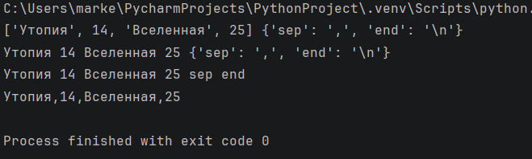
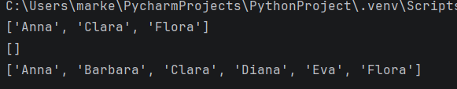
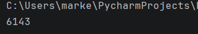
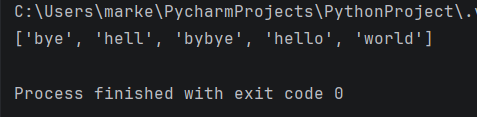
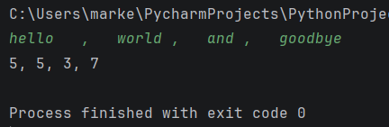
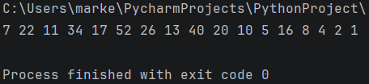
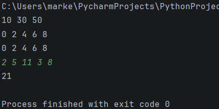
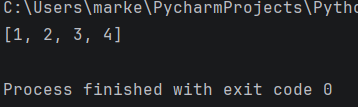
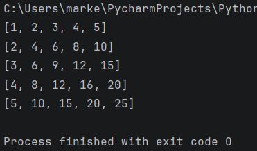
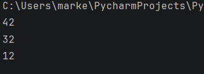

# Языки программирования
## Лабораторная работа 9

### Задание 1 **(2)**
*Рассмотрим следующую программу.*
```
d = {'sep': ',' , 'end': '\n'}
l = ['Утопия', 14, 'Вселенная', 25]
print (l, d)
print (*l, d)
print (*l, *d)
print (*l, **d)
```
*Объясните результаты ее работы.*

*При устном ответе на вопросы вам потребуется рассказать, что такое "Утопия 14" и "Вселенная 25".*
 

**Решение**

1. `print(l, d)` передает оба объекта как обычные позиционные аргументы. Поэтому выводятся представления списка и словаря:
   ```text
   ['Утопия', 14, 'Вселенная', 25] {'sep': ',', 'end': '\\n'}
   ```
2. `print(*l, d)` распаковывает список `l` в отдельные позиционные аргументы, а словарь `d` передает целиком последним аргументом. Между аргументами используется стандартный разделитель — пробел.
3. `print(*l, *d)` распаковывает список и словарь. При распаковке словаря `*d` передаются его ключи (`'sep'` и `'end'`), а не значения:
   ```text
   Утопия 14 Вселенная 25 sep end
   ```
4. `print(*l, **d)` распаковывает список в позиционные аргументы, а словарь — в именованные аргументы. Ключи словаря задают параметры `print`: `sep=','` и `end='\\n'`. Поэтому элементы списка выводятся через запятую:
   ```text
   Утопия,14,Вселенная,25
   ```

«Утопия 14» и «Вселенная 25» — это пары соседних элементов исходного списка: строка и следующее за ней число.




### Задание 2 **(2)**
*Напишите функцию* **sublist** для решения следующей задачи.*

*На вход функции поступает список или кортеж и набор номеров позиций.
Функция должна составить и вернуть список из элементов, которые
находятся на этих позициях. Примеры работы приводятся ниже. Работа функции должна строго им соответствовать.*

```
>>> lst = [ 'Anna', 'Barbara', 'Clara', 'Diana', 'Eva', 'Flora']
>>> sublist(lst, 0, 2, 5)
['Anna', 'Clara', 'Flora']
>>> sublist (lst)
[]
>>> sublist(lst, 0, 1, 2, 3, 4, 5)
['Anna', 'Barbara', 'Clara', 'Diana', 'Eva', 'Flora']
```


**Решение**

```python
def sublist(seq, *positions):
    return [seq[i] for i in positions]


lst = ['Anna', 'Barbara', 'Clara', 'Diana', 'Eva', 'Flora']

print(sublist(lst, 0, 2, 5))
print(sublist(lst))
print(sublist(lst, 0, 1, 2, 3, 4, 5))
```

Если позиции не переданы, `positions` — пустой кортеж, поэтому функция возвращает пустой список.




### Задание 3 **(1)**

*Задан список* **lst** *из натуральных чисел*. *Напишите фрагмент
программы, состоящий из одного вызова функции* **max**, *который найдет в этом списке число с максимальным
числом единиц в двоичной записи.* 

*Многоточие надо заменить на лямбда-функцию, использующую фукцию* **bin** *и метод строк* **count**.

*Пример работы приводится ниже.*
```
>>> lst = list(range(6000 ,7000))
>>> ans = max(lst,...)
>>> print(ans)
6143
```


**Решение**

```python
lst = list(range(6000, 7000))

ans = max(lst, key=lambda x: bin(x).count('1'))

print(ans)
```

`bin(x)` возвращает двоичное представление числа в виде строки с префиксом `0b`, а `count('1')` подсчитывает количество единиц. Параметр `key` задает критерий сравнения. Если максимум достигается несколькими числами, `max` возвращает первое из них в исходной последовательности.




### Задание 4 **(2)**

*Запишите фрагмент программы, которая упорядочит список слов
по длине, а при равенстве длины - лексикографически. Сортировка
должна состоять из одного вызова метода* **sort**.

*Пример работы приводится ниже.*

```
>>> lst = ['hello', 'hell', 'bye', 'world', 'bybye']
>>> lst.sort (...)
>>> print (lst)
['bye', 'hell', 'babye', 'hello', 'world']
```


**Решение**

```python
lst = ['hello', 'hell', 'bye', 'world', 'bybye']

lst.sort(key=lambda word: (len(word), word))

print(lst)
```

Кортеж-ключ сначала сравнивается по длине слова, а при равной длине — лексикографически. В примере задания в ожидаемом выводе указано `babye`, хотя во входном списке находится `bybye`. При сортировке исходного списка результатом будет `bybye`:

```text
['bye', 'hell', 'bybye', 'hello', 'world']
```




### Задание 5 **(2)**

*Напишите программу для решения следующей задачи.*

*В одной строке через запятую записана последовательность слов. Перед
запятой или после нее могут быть пробелы, сами слова пробелов не
содержат. Программа должна вывести в одной строке через запятую
последовательность чисел, равных длине каждого слова. Например,
для ввода*
```
hello   ,   world ,   and ,   goodbye
```
*программа должна вывести*
```
5, 5, 3, 7
```
*Программа должна быть написана с использованием парадигмы функционального программирования, то есть без использования циклов, присваиваний и т.д. Программа может использовать функции* **input**, **print**, **len**, **map** *и методы строк* **split** и **strip**.


**Решение**

```python
print(*map(len, map(str.strip, input().split(','))), sep=', ')
```


`split(',')` разделяет введенную строку по запятым, `strip` удаляет пробелы по краям каждого слова, а `len` вычисляет длину каждого слова.
Функция map последовательно применяет указанные функции без использования циклов. Оператор `*` распаковывает полученные длины в аргументы `print`, а параметр `sep=', '` задает разделитель между ними.




### Задание 6 **(2)**

*Запишите генератор в форме функции, который будет создавать
последовательность по следующему правилу.*

* *Если текущее число x в последовательности четное, то следующее число равно x/2.*
* *Иначе следующее число равно 3x + 1.* 

*Последовательность начинается с заданного числа n и заканчивается единицей.*

*Далее приведен пример работы генератора.*
```
>>> print (*gen(7))
7 22 11 34 17 52 26 13 40 20 10 5 16 8 4 2 1
```


**Решение**

```python
def gen(n):
    x = n

    while True:
        yield x

        if x == 1:
            break

        if x % 2 == 0:
            x //= 2
        else:
            x = 3 * x + 1


print(*gen(7))
```

Генератор выдает текущее число, затем вычисляет следующее по правилу задания. После выдачи единицы он завершает работу.




### Задание 7 **(2)**

*Напишите генератор, который для заданной последовательности*
**seq** *будет задавать последовательность из каждого второго элемента* **seq**.

```
def every_other ( seq )
    ...
```
*Ниже приведены примеры использования генератра.*
```
>>> print (*every_other([10, 20, 30, 40, 50]))
10 30 50
>>> print(*every_other(range(10)))
0 2 4 6 8
>>> print(*every_other(iter(range(10))))
0 2 4 6 8
>>> print(sum(every_other(map(int, input().split()))))
2 5 11 3 8
21
```


**Решение**

```python
def every_other(seq):
    it = iter(seq)

    while True:
        try:
            yield next(it)
            next(it)
        except StopIteration:
            return


print(*every_other([10, 20, 30, 40, 50]))
print(*every_other(range(10)))
print(*every_other(iter(range(10))))
print(sum(every_other(map(int, input().split()))))
```

Генератор работает с любым итерируемым объектом, в том числе с итератором, и не требует предварительного преобразования последовательности в список. Он выдает первый элемент, пропускает следующий и повторяет это действие.




### Задание 8 **(2)**

*Задан список* **lst**, *в котором записаны вперемешку числа и строки.*. 
*Напишите фрагмент программы, состоящий из одного конструктора списков, который построит новый список, состоящий только из чисел.* 

*Определить тип объекта в Python можно с использованием функции* **type**.

*Пример работы приводится ниже.*

```
>>> lst = [1,'abc', 2, 3, 4, 'aa']
>>> nums = [...]
>>> print(nums)
[1, 2, 3, 4]
```


**Решение**

```python
lst = [1, 'abc', 2, 3, 4, 'aa']

nums = [x for x in lst if type(x) is int]

print(nums)
```

Конструктор списка оставляет только объекты, точный тип которых — `int`.




###  Задание 9 **(2)**

*Напишите фрагмент программы, состоящий из одного конструктора списков, который построит двумерный список в виде таблицы умножения размера* 
**n×n**.

*Пример работы приводится ниже.*

```
>>> n = 5
>>> tblmul = [...]
>>> print(*tblmul,sep='\n')
[1, 2, 3, 4, 5]
[2, 4, 6, 8, 10]
[3, 6, 9, 12, 15]
[4, 8, 12, 16, 20]
[5, 10, 15, 20, 25]
```


**Решение**

```python
n = 5

tblmul = [[i * j for j in range(1, n + 1)] for i in range(1, n + 1)]

print(*tblmul, sep='\n')
```

Внешний конструктор создает строки таблицы, внутренний — элементы каждой строки. Оба диапазона начинаются с 1 и включают `n`.




###  Задание 10 **(1)**
*Какие из указанных функций и методов Python соответствуют определению чистых функций?
В случае отрицательного ответа требуется дать пояснение.*

* **file.readline|** — *чтение строки из файла.*
* **len** — *определение длины строки или количества элементов в контейнере.*
* **list.append** — *добавление в список нового элемента.*
* **sum** — *нахождение суммы.*
* **sorted** — *построение сортированного списка.*
* **list.sort** — *сортировка списка.*
* **random.randint** — *генерация случайного целого числа.*
* *Разворот списка.*
```
def rev(x):
    return x[::-1]
```
* *Выбор нескольких элементов из хвоста списка.*
```
tail_len = 3
def tail(x):
    return x[-tail_len:]
```


**Решение**

Чистая функция при одинаковых аргументах возвращает одинаковый результат и не изменяет внешнее состояние.

| Функция или метод | Чистая? | Объяснение |
|---|---|---|
| `file.readline` | Нет | Читает текущее содержимое файла и сдвигает файловую позицию; результат зависит от состояния файла. |
| `len` | Да | Возвращает длину объекта и не изменяет его. |
| `list.append` | Нет | Изменяет исходный список. |
| `sum` | Да | Вычисляет сумму элементов, не изменяя исходную последовательность. |
| `sorted` | Да | Возвращает новый отсортированный список, не изменяя исходный итерируемый объект (при использовании чистого ключа сортировки). |
| `list.sort` | Нет | Сортирует список на месте, то есть изменяет его. |
| `random.randint` | Нет | Результат зависит от состояния генератора случайных чисел. |
| `rev(x)` | Да | Срез `x[::-1]` создает новый объект и не изменяет `x`; результат определяется аргументом. |
| `tail(x)` | В данном виде — нет | Результат зависит не только от `x`, но и от внешней переменной `tail_len`. Если передавать длину хвоста явным аргументом, функция будет чистой при неизменяемых входных данных. |

Функции `len`, `sum`, `sorted` и `rev` являются чистыми при обычном использовании с данными, не меняющимися во время вычисления. Для `sorted` также важно, чтобы переданная функция `key`, если она есть, сама не имела побочных эффектов.


###  Задание 11 **(2)**
*Рассмотрите следующую функцию.*
```
def toint(fun):
    def wrapper(*args):
        return fun(*map(int, args))
    return wrapper
```
*Что передается в функцию* **toint**? *Что возвращает эта функция?*
*Что делает функция* **wrapper**?
*Придумайте несколько примеров использования* **toint**.


**Решение**

- В `toint` передается функция (или другой вызываемый объект), которую требуется обернуть.
- `toint` возвращает функцию `wrapper`. То есть `toint` — функция высшего порядка.
- `wrapper(*args)` принимает произвольное количество позиционных аргументов, преобразует каждый из них в целое число с помощью `int` и передает преобразованные значения исходной функции `fun`. Результат вызова `fun` возвращается вызывающему коду.
- Именованные аргументы эта реализация `wrapper` не поддерживает, поскольку в ее параметрах нет `**kwargs`.

Примеры:

```python
def toint(fun):
    def wrapper(*args):
        return fun(*map(int, args))
    return wrapper


def add(a, b):
    return a + b


def power(a, b):
    return a ** b


int_add = toint(add)
int_power = toint(power)

print(int_add('12', '30'))
print(int_power('2', '5'))
print(toint(max)('7', '12', '3'))
```

В этих примерах строки преобразуются в целые числа до вызова `add`, `power` или `max`.




## Дополнительные задания

### Задание 1 **(3)**

*Самостоятельно познакомьтесь с понятием декораторов в Python. Приведите примеры использования
функции* **toint** *из задания выше в качестве декоратора.*


### Задание 2 **(3)**
*Напишите фрагмент программы, которая найдет в списке слов слово с максимальной длиной. При равенстве длин
найдет самое первое в лексикографическом порядке.*

*Фрагмент программы должен состоять из одного вызова функции* **min** *или* **max**.

### Задание 3 **(5)**

*Напишите рекурсивную функцию для нахождения* **n**-о *числа Фибоначчи.*

*Функция обязательно должна работать с достаточно большими числами, например* **n = 1000** *и не 
должна использовать библиотечные функции и методы.*

### Задание 4 **(9)**

*Напишите функцию* **fastpow**, *которая будет создавать лямбда-функцию для быстрого 
возведения в фиксированную степень* **n**. *Например, должен работать следующий код*
```
>>> pow10 = fastpow(10)
>>> print(pow10(2))
1024
```
*Функция* **fastpow** *в этом примере должна строить выражение для быстрого возведения в степень
по стандартному алгоритму* 
* **x^1 = x**;
* **x^{2n} = (x^n) ** 2**; 
* **x^{2n+1}=x*x^{2n}**;

*Например,
для* **n = 10** *может быть получена подобная строка* ```(x*((x**2)**2))**2```. 

*Далее* **fastpow** *будет возвращать лямбда функцию*
```
lambda x: eval(s)
```
*При написании функции* **fastpow** *можно использовать вспомогательные функции.*

