# Языки программирования
## Лабораторная работа 10

### Задание 1 **(2)**

*Рассмотрите следующие фрагменты программ. Запишите, что означают символы* **&** и  * *в каждом случае применения.*
```
int a = 10, b = 20;
int *p = &a , *q = &b;
p = q;
std::cout << *p <<' '<< *q << std::endl;
```
```
int a = 10, b = 20;
int *p = &a , *q = &b;
*p = *q;
std::cout << *p <<' '<< *q << std::endl;
```
*Чем различаются присваивания в третьей строке? Что можно вывести,
чтобы показать различия?*

*Примеры программ сохраните в папке с номером задания. Скриншоты работы прикрепите к отчету.*


**Решение**

```cpp
#include <iostream>

int main() {
    {
        int a = 10, b = 20;
        int *p = &a, *q = &b;
        p = q;
        std::cout << *p << ' ' << *q << std::endl;
        std::cout << p << ' ' << q << ' ' << a << ' ' << b << std::endl;
    }

    {
        int a = 10, b = 20;
        int *p = &a, *q = &b;
        *p = *q;
        std::cout << *p << ' ' << *q << std::endl;
        std::cout << p << ' ' << q << ' ' << a << ' ' << b << std::endl;
    }

    return 0;
}
```

Оператор `&` в выражении `&a` и `&b` является оператором взятия адреса: он возвращает адрес соответствующей переменной. Запись `int *p` объявляет указатель на `int`, а `*p` в выражении означает разыменование указателя — получение значения, хранящегося по адресу.

В первом фрагменте выполняется `p = q`. Это копирование адреса: после присваивания оба указателя `p` и `q` указывают на переменную `b`. Переменная `a` остаётся равной 10, `b` — 20. Поэтому вывод значений `*p` и `*q` будет `20 20`.

Во втором фрагменте выполняется `*p = *q`. Здесь копируется не адрес, а значение: значение переменной `b` записывается в переменную `a`. Указатели сохраняют прежние адреса: `p` указывает на `a`, `q` — на `b`. После присваивания обе переменные равны 20, поэтому вывод также будет `20 20`.

Чтобы показать различие, недостаточно вывести только `*p` и `*q`: нужно дополнительно вывести сами указатели и переменные `a` и `b`. В первом случае адреса `p` и `q` совпадут, а во втором останутся различными. При этом в первом случае `a` не изменится, а во втором станет равна `b`.

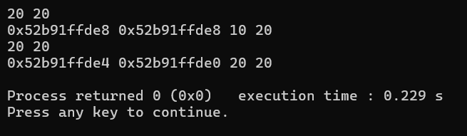


### Задание 2 **(1)**

*Рассмотрим следующую программу.* 
```
double x[10];
for (int i = 0; i <10; i++)
    std::cout << &x[i] << std::endl;
```
*Что она выводит? Измените
вывод так, чтобы адреса выводились в десятичной системе счисления.
Объясните почему числа составляют арифметическую прогрессию с
определенным шагом.*

*Записанную программу сохраните в папке с номером задания.*
*Скриншоты работы прикрепите к отчету.*


**Решение**

```cpp
#include <iostream>

int main() {
    double x[10];
    
    for (int i = 0; i < 10; i++) {
        std::cout << reinterpret_cast<std::uintptr_t>(&x[i]) << std::endl;
    }
    
    return 0;
}
```

Программа выводит адреса элементов массива `x`. В стандартном выводе они обычно представлены в шестнадцатеричной системе счисления. Адрес — это числовое значение, обозначающее место элемента в памяти, а не само значение элемента массива.

Чтобы вывести адреса в десятичной системе, адрес можно преобразовать к целочисленному типу `std::uintptr_t` из заголовка `<cstdint>`, если реализация предоставляет этот тип. Затем значение выводится как целое число.

Элементы массива расположены последовательно. Тип `double` обычно занимает 8 байт, поэтому адрес каждого следующего элемента увеличивается на 8. В общем случае шаг равен `sizeof(double)`, а не обязательно 8: размер типа определяется реализацией. Получается арифметическая прогрессия адресов:
`A(i) = A(0) + i * sizeof(double)`.


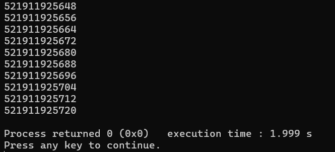


### Задание 3 **(2)**

*Токен* **«*»** *в языке C++ может использоваться в трех различных
случаях. Аналогично токен* **«&»** *также может использоваться в трех
случаях. Приведите пример одной программы в которой они были бы
использованы во всех случаях.*

*Записанную программу сохраните в папке с номером задания.*


**Решение**
```cpp
#include <iostream>

int main() {
    int a = 6;
    int b = 3;

    int *p = &a;

    std::cout << "Address of a: " << &a << std::endl;

    std::cout << "Value through pointer: " << *p << std::endl;

    std::cout << "Multiplication: " << a * b << std::endl;

    int &reference = a;
    reference = 8;
    std::cout << "Reference value: " << reference << std::endl;

    std::cout << "Bitwise AND: " << (a & b) << std::endl;

    return 0;
}
```

Токен `*` используется в трёх ролях: при объявлении указателя (`int *p`), при разыменовании указателя (`*p`) и как оператор умножения (`a * b`). Токен `&` также имеет три применения: объявление ссылки (`int &r`), получение адреса (`&a`) и побитовое И (`a & b`).

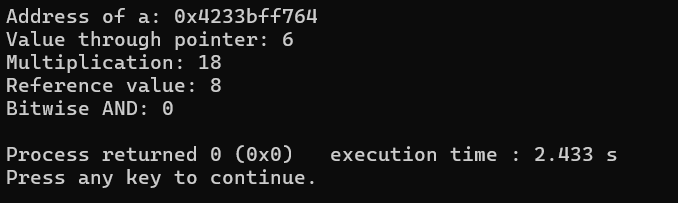


### Задание 4 **(2)**

*Выпишите значения всех переменных, в том числе указателей,
после выполнения каждой инструкции программы. Объясните, что
происходит в результате выполнения каждой инструкции.*
```
unsigned a = 8, b = 3 ,c = 17;
unsigned *p = &a;
unsigned *q = &b;
*p += *q + c;
c = *q;
p = &c;
c += a;
*p += 10;
*q = *p;
q = p ;
*q += 10;
```


**Решение**

```cpp
#include <iostream>

int main() {
    unsigned a = 8, b = 3, c = 17;
    unsigned *p = &a;
    unsigned *q = &b;

    *p += *q + c;
    c = *q;
    p = &c;
    c += a;
    *p += 10;
    *q = *p;
    q = p;
    *q += 10;

    std::cout << "a = " << a << std::endl;
    std::cout << "b = " << b << std::endl;
    std::cout << "c = " << c << std::endl;
    std::cout << "p points to c: " << (p == &c) << std::endl;
    std::cout << "q points to c: " << (q == &c) << std::endl;

    return 0;
}
```

Начальные значения: `a = 8`, `b = 3`, `c = 17`. Указатель `p` хранит адрес `a`, а `q` — адрес `b`.

| Инструкция | `a` | `b` | `c` | `p` указывает на | `q` указывает на | Объяснение |
|---|---:|---:|---:|---|---|---|
| `unsigned a = 8, b = 3, c = 17;` | 8 | 3 | 17 | — | — | Создаются три беззнаковые переменные |
| `unsigned *p = &a;` | 8 | 3 | 17 | `a` | — | `p` получает адрес `a` |
| `unsigned *q = &b;` | 8 | 3 | 17 | `a` | `b` | `q` получает адрес `b` |
| `*p += *q + c;` | 28 | 3 | 17 | `a` | `b` | К `a` прибавляется `b + c`, то есть `3 + 17` |
| `c = *q;` | 28 | 3 | 3 | `a` | `b` | В `c` записывается значение, на которое указывает `q`, то есть `b` |
| `p = &c;` | 28 | 3 | 3 | `c` | `b` | `p` перенаправляется с `a` на `c`; значения переменных не меняются |
| `c += a;` | 28 | 3 | 31 | `c` | `b` | К `c` прибавляется `a`: `3 + 28` |
| `*p += 10;` | 28 | 3 | 41 | `c` | `b` | Через `p` изменяется `c`: `31 + 10` |
| `*q = *p;` | 28 | 41 | 41 | `c` | `b` | Значение `c` записывается в `b` |
| `q = p;` | 28 | 41 | 41 | `c` | `c` | `q` получает тот же адрес, что и `p`; оба указывают на `c` |
| `*q += 10;` | 28 | 41 | 51 | `c` | `c` | Через `q` к `c` прибавляется 10 |

Итоговые значения: `a = 28`, `b = 41`, `c = 51`. Оба указателя `p` и `q` в конце указывают на переменную `c`.

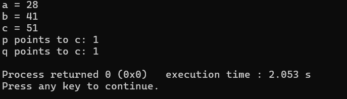


### Задание 5 **(1)**

*Что сравнивается в приведенной ниже программе? Как можно
изменить первую строчку программы, чтобы результат тоже
изменился?*
```
int x = 1, y = 2;
int *p = &y, *q = &x;
if (p < q)
    std::cout << "Yes";
else
    std::cout << "No";
```


**Решение**

```cpp
#include <iostream>

int main() {
    int y = 2, x = 1;
    int *p = &y, *q = &x;

    if (p < q)
        std::cout << "Yes" << std::endl;
    else
        std::cout << "No" << std::endl;
    return 0;
}
```

В выражении `p < q` сравниваются значения указателей, то есть адреса объектов `y` и `x`, а не значения переменных `y` и `x`. Поскольку указатели указывают на два разных самостоятельных объекта, результат такого относительного сравнения в общем случае не следует считать переносимым: стандарт C++ не задаёт универсального порядка для указателей на несвязанные объекты.

Изменение первой строки может повлиять на расположение переменных в памяти, но полагаться на это нельзя. Чтобы получить определённый и осмысленный результат, следует сравнивать указатели на элементы одного массива либо сравнивать сами значения `x` и `y`, если требуется именно сравнение чисел.

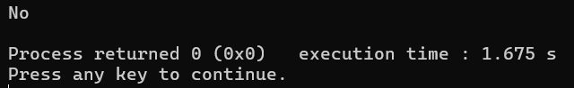


### Задание 6 **(2)**

*Объясните работу следующей программы. Как изменится
результат, если тип* **double** *изменить на некоторый другой, например*
**int** *или* **char**?
```
double x = 0;
double *d = &x;
std::cout << reinterpret_cast<size_t>(d + 4) - reinterpret_cast<size_t>(d - 4) << std::endl;
```


**Решение**

```cpp
#include <iostream>

int main() {
    double x = 0;
    double *d = &x;

    std::cout << "d = " << reinterpret_cast<size_t>(d) << std::endl;
    std::cout << "d+4 = " << reinterpret_cast<size_t>(d+4) << std::endl;
    std::cout << "d-4 = " << reinterpret_cast<size_t>(d-4) << std::endl;

    std::cout << reinterpret_cast<size_t>(d + 4) - reinterpret_cast<size_t>(d - 4) << std::endl;

    return 0;
}
```

В выражениях `d + 4` и `d - 4` указатель смещается на четыре элемента типа `double` вперёд и назад. Арифметика указателей учитывает размер типа: смещение на один элемент соответствует `sizeof(double)` байтам. Поэтому разность адресов в байтах между такими позициями равна `8 * sizeof(double)`; при типичном размере `double` в 8 байт это 64 байта.

Однако в исходном фрагменте `d` указывает на единственную переменную `x`. Вычисление `d + 4` и особенно `d - 4` выходит за допустимые границы объекта. Такое использование указателей приводит к неопределённому поведению, поэтому конкретный вывод программы стандартом C++ не гарантируется.

Если заменить `double` на `int`, типичный размер будет 4 байта, и аналогичное формальное смещение составило бы 32 байта. Для `char` размер всегда равен одному байту, поэтому формальное смещение составило бы 8 байт. Но проблема выхода за границы объекта останется во всех трёх случаях. Корректный эксперимент нужно проводить внутри массива, например используя указатель на его центральный элемент.

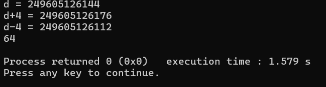


### Задание 7 **(2)**

*Объясните работу следующей программы. Как изменится
результат, если тип* **double** *изменить на некоторый другой, например*
**int** *или* **char**?
```
std::cout << reinterpret_cast <double*>(3000) - reinterpret_cast <double*>(2000) << std::endl;
```


**Решение**

```cpp
#include <iostream>

int main() {
    std::cout << reinterpret_cast <double*>(3000) - reinterpret_cast <double*>(2000) << std::endl;

    return 0;
}
```

`reinterpret_cast<double*>(3000)` и `reinterpret_cast<double*>(2000)` преобразуют целые числа в значения-указатели. Оператор вычитания указателей предназначен для определения расстояния между элементами одного массива и возвращает количество элементов, а не количество байтов.

В данном примере указатели не указывают на элементы одного массива. Кроме того, преобразование произвольных целых чисел в указатели не гарантирует получение действительных адресов объектов. Следовательно, вычитание этих указателей имеет неопределённое поведение, и стандарт C++ не гарантирует конкретный результат.

Если рассматривать только разность числовых адресов, она равна 1000 байтам. При условном размере `double` 8 байт это соответствовало бы 125 элементам, для `int` размером 4 байта — 250 элементам, а для `char` — 1000 элементам. Но это лишь арифметическая иллюстрация, а не гарантированный результат исходной программы. Для корректного вычисления расстояния следует вычитать указатели на элементы одного массива.

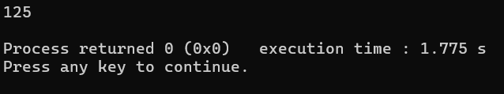


### Задание 8 **(2)**

*Что надо дописать в записанной ниже программе вместо многоточий, чтобы
она выводила все числа из массива* **a**? *Почему?*
```
int a[20];
for ( int i = 0; i < 20; i++)
    a[i] = i;
int *b=a + 8;
for (int i =...; i <...; i++)
    std::cout << b[i] <<' ';
```


**Решение**

```cpp
#include <iostream>

int main() {
    int a[20];

    for (int i = 0; i < 20; i++)
        a[i] = i;

    int *b = a + 8;

    for (int i = -8; i < 12; i++)
        std::cout << b[i] << ' ';

    return 0;
}
```

Указатель `b` установлен на элемент `a[8]`. При обращении `b[i]` выполняется то же действие, что и `*(b + i)`. Поэтому для получения элементов массива с индексами от 0 до 19 индекс относительно `b` должен изменяться от -8 до 11 включительно.

Вместо многоточий нужно записать:

- начальное значение `i`: `-8`;
- условие продолжения цикла: `i < 12`.

Отрицательные индексы здесь допустимы, потому что `b` указывает не на начало массива, а на его девятый элемент. При `i = -8` выражение `b[i]` обращается к `a[0]`, а при `i = 11` — к `a[19]`. Все обращения остаются внутри исходного массива.

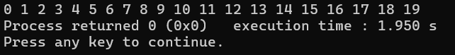


### Задание 9 **(2)**

*Что выводит следующая программа? Изменится ли результат если
изменить тип элементов массива?*

```
int a[10];
std::cout << &a[8] - &a[3] << std::endl;
```


**Решение**

```cpp
#include <iostream>

int main() {
    int a[10];

    std::cout << &a[8] - &a[3] << std::endl;

    return 0;
}
```

Выражение `&a[8] - &a[3]` вычитает указатели на два элемента одного массива. Результат такого вычитания измеряется в количестве элементов, а не в байтах. Между индексами 3 и 8 разница составляет `8 - 3 = 5`, поэтому программа выводит `5`.

Если изменить тип элементов массива, результат не изменится: разность указателей на элементы одного массива по-прежнему выражается в количестве элементов. Изменится только расстояние в байтах между адресами, но не результат вычитания указателей.

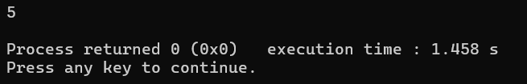


### Задание 10 **(1)**

*Есть ли разница между инициализацией* **p** и **q** *в следующей программе? Обоснуйте ответ.*
```
int x [10]={1, 2, 3, 4, 5, 6, 7, 8, 9, 10};
int *p = x + 5;
int *q = &x[5];
```


**Решение**

```cpp
#include <iostream>

int main() {
    int x[10] = {1, 2, 3, 4, 5, 6, 7, 8, 9, 10};

    int *p = x + 5;
    int *q = &x[5];

    std::cout << "p = " << p << std::endl;
    std::cout << "q = " << q << std::endl;
    std::cout << "Equal addresses: " << (p == q) << std::endl;
    std::cout << "*p = " << *p << ", *q = " << *q << std::endl;

    return 0;
}
```

Разницы между инициализацией `p` и `q` нет. Выражение `x + 5` даёт указатель на элемент массива с индексом 5, а `&x[5]` непосредственно получает адрес этого же элемента. Поэтому после инициализации `p` и `q` содержат одинаковый адрес и указывают на `x[5]`.

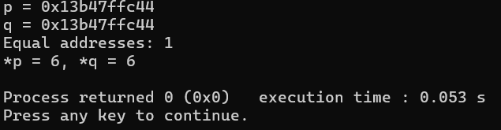


### Задание 11 **(3)**

*Указатели можно использовать для итерации по массивам.
Напишите программу, которая найдет сумму элементов массива,
используя указатели. В начале цикла указатель требуется установить
на начало массива, в конце каждой итерации смещать его к
следующему элементу массива через инкремент. Для выхода из цикла
надо проверять, что указатель дошел до конца массива.*
```
int x [10]={1, 2, 3, 4, 5, 6, 7, 8, 9, 10};
int s = 0;
for (int *p = ...; ...; ...)
    s += ...
std::cout << s;
```

*Записанную программу сохраните в папке с номером задания.*


**Решение**

```cpp
#include <iostream>

int main() {
    int x[10] = {1, 2, 3, 4, 5, 6, 7, 8, 9, 10};
    int s = 0;

    for (int *p = x; p < x + 10; ++p)
        s += *p;

    std::cout << s;

    return 0;
}
```

Для перебора элементов массива используется указатель `p`. В начальной части цикла `int *p = x` он устанавливается на первый элемент массива. Имя массива `x` в этом выражении преобразуется в указатель на `x[0]`.

Условие `p < x + 10` проверяет, что указатель ещё не дошёл до позиции сразу после последнего элемента. Выражение `x + 10` указывает на позицию за последним элементом; её можно использовать для сравнения, но нельзя разыменовывать. Когда `p` достигает этого адреса, цикл завершается.

В конце каждой итерации выполняется `++p`. Указатель перемещается к следующему элементу массива, а не просто к следующему байту памяти. В теле цикла `*p` получает значение элемента, на который в данный момент указывает `p`, и это значение прибавляется к переменной `s`.

Таким образом, цикл последовательно складывает все десять элементов массива. Их сумма равна:

```s = 1 + 2 + 3 + 4 + 5 + 6 + 7 + 8 + 9 + 10 = 55```

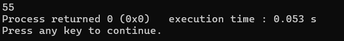


## Дополнительные задания

### Задание 1 **(3)**

*Запишите программу на С++, в которой будет создаваться двумерный массив* **x[10][10]**. *Выведите адреса элементов массива и нарисуйте, как элементы расположены в памяти.*

### Задание 2 **(3)**

*Запишите программу на С++, в которой будет создаваться двумерный массив* **x[10][10]**. *Проверьте, что произойдет при различных выходах за границы массива. Напишите программы для демонстрации и поясните
их работу.* 

### Задание 3 **(6)**
*Напишите пример программы, которая продемонстрирует неопределенное поведение при выходе за границу одномерного массива. Например, чтобы программа зависла, хотя по алгоритму такого не должно произойти

### Задание 4 **(8)**
*Изучите самостоятельно работу с динамической памятью. Напишите примеры программ, демонстрирующие особенности работы (например, перемещение при расширении) и возможные ошибки при работе с памятью.* 

